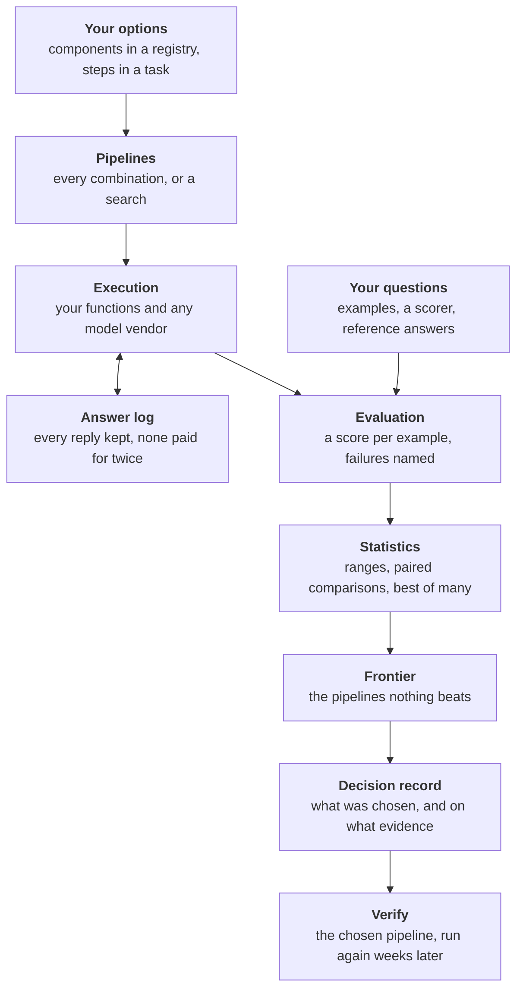

# How FrontierKit works

FrontierKit answers one question: of the setups you could use, which one should
you use, and how sure can you be? A setup is a pipeline: one choice for each
step, such as a way of finding context, a prompt and a model.

It gets there in stages. You describe your questions and your options, it runs
every pipeline on every question, scores the answers, works out what the scores
can and cannot tell apart, and keeps the pipelines nothing beats. The choice can
be written down and checked again later.

## What you describe

- A **component** is one option for one step: a model, a prompt template, a
  retriever. `ComponentMetadata` describes it, with the step it can fill and
  starting guesses for its cost, speed and reliability.
- A **registry** (`CapabilityRegistry`) holds the components. It can be saved
  to and loaded from a JSON file, and `frontierkit-registry validate` checks
  such a file.
- A **task** (`TaskSpecification`) names the steps a pipeline needs, in order,
  with optional limits on cost, latency and privacy.
- An **eval set** (`EvalSet`) holds your examples and how to grade an answer.

The declared numbers are only starting guesses. Everything that follows is
measured.

## Pipelines

A pipeline is one component per step, run as a straight chain (`AgentGraph`).

- `enumerate_pipelines` lists every pipeline the task allows, and
  `count_pipelines` says how many that is before any call is made. Trying them
  all is the dependable way.
- When there are too many to try, `run_closed_loop` chooses which to score next
  from the scores it has seen. On the project's benchmark it currently finds
  the best pipeline in about as many calls as picking at random.
- The synthesizers (`ExhaustiveSynthesizer`, `ProgressiveParetoBeamSynthesizer`
  and others) search on declared numbers alone, without running anything.
  [Benchmarks](BENCHMARKS.md) compares them.

## Execution

`AgentExecutor` runs a pipeline step by step, handing each step's output to the
next. A backend decides how a step runs:

| Backend | What it runs |
|---|---|
| `CallableBackend` | Your own Python functions |
| `OpenAIBackend` | Any vendor or local server that accepts OpenAI-style chat requests |
| `RoutedBackend` | A different backend for each component, to mix vendors and functions |
| `LoggedBackend` | Any of the above, with every answer written to an `AnswerLog` |

Each step is timed and costed, and a pipeline stops at its first failed step. A
failure is recorded as what it was: `rate_limited`, `timeout`, `unavailable`,
`not_found`, `auth`, `empty_output`, `step_failed` or `error`.

With an answer log, a step that was already answered is read back from the file
instead of being called again. What makes two calls the same is what ran (the
endpoint, model and request options, or a version you give your own function)
and what it was asked.

Without a backend the executor simulates: steps succeed always, or with the
probability their declared reliability gives. That mode exists to test search
strategies and produces no answers to score.

## Evaluation

`evaluate_pipelines` runs every pipeline on every example and returns a
`PipelineEvaluation` for each:

- `quality`: the mean score, counting a failed run as 0.
- `scores`, `outputs`, `latencies` and `errors`: what happened on each example.
- `cost`, `latency_ms` and `success_rate`: measured, not declared.
- `metrics`: figures over the whole set, such as precision pooled over a corpus.

Scorers grade one answer against its reference. `exact_match`,
`contains_answer` and `token_f1` cover short answers, and `triple_precision`,
`triple_recall` and `triple_f1` cover extracted triples. Any function returning
a number from 0 to 1 works.

## Statistics

A score from a few dozen examples could easily have come out higher or lower.

- `mean_interval` gives the range a quality plausibly lies in.
- `paired_difference` compares two pipelines example by example and answers
  "first is better", "second is better" or "too close to call".
- `best_of` reports the winner among many with the luck of the pick taken out,
  and lists the pipelines that cannot be told apart from it.
- `metric_interval` gives a range for a figure over the whole set.

The default method only assumes scores stay between known bounds. It is valid
for any number of examples and stays valid when you look repeatedly as examples
arrive. See [How sure is the result](USAGE.md#how-sure-is-the-result).

## Frontier

`quality_frontier` keeps the pipelines that are not beaten. One pipeline beats
another when it is at least as good on measured quality, cost and latency, and
strictly better on one of them. What is left is the set of real trade-offs; the
choice among them is yours.

## Decisions that can be checked

`record_decision` writes down which pipeline was chosen, what each step ran on,
the range of every score, each pipeline compared with the chosen one, and the
failures by kind. `verify_decision`, or `frontierkit verify` on the command
line, runs the chosen pipeline again on the same examples and answers:

| Status | Meaning |
|---|---|
| `valid` | No drop in quality was found, and it is not slower |
| `quality_dropped` | The same examples now score lower, by more than chance explains |
| `slower` | Quality held, but most runs take much longer |
| `unavailable` | The service refused, timed out, or no longer knows the model |
| `not_comparable` | Other examples, or a step that now runs on something else |

## Declared numbers and measured ones

`calibrate` blends what runs recorded into a new registry: a component seen a
few times barely moves from its declared values, and one seen often converges
on what was measured. `calibrate_quality` does the same for answer quality.
`run_closed_loop` uses both between rounds.

## Where the code lives

| Package | Holds |
|---|---|
| `frontierkit.registry` | Components, registries and registry files |
| `frontierkit.synthesis` | Tasks, enumeration and the search strategies |
| `frontierkit.graph` | A pipeline as a chain of components |
| `frontierkit.execution`, `frontierkit.adapters` | The executor, backends and failure kinds |
| `frontierkit.store` | The answer log |
| `frontierkit.evaluation` | Eval sets, scorers and whole-set metrics |
| `frontierkit.stats` | Ranges, paired comparisons and best of many |
| `frontierkit.optimization` | Which pipelines beat which |
| `frontierkit.telemetry`, `frontierkit.loop` | Calibration and the closed loop |
| `frontierkit.decision`, `frontierkit.verify`, `frontierkit.cli` | Decision records and checking them |

## Limits

- Pipelines are straight chains of steps. Branching pipelines are not searched.
- A few dozen examples can only separate large differences. The results say
  what they cannot tell apart.
